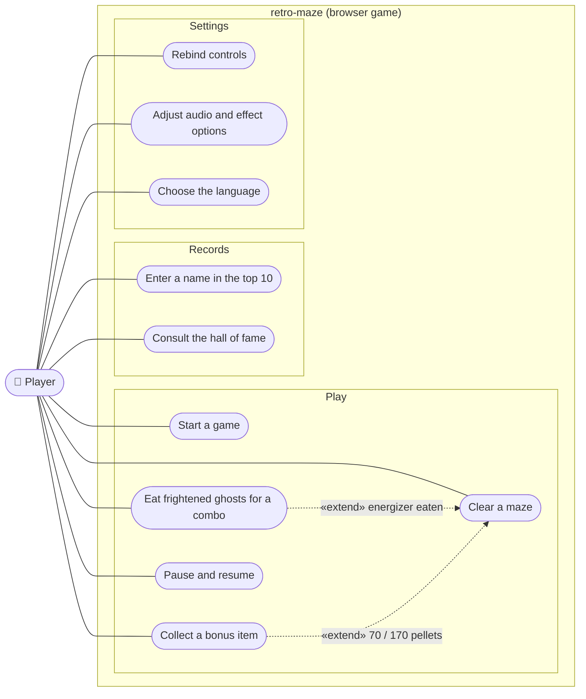

# uc — retro-maze player goals

## Context

Who interacts with the game, and to do what. Goals are actor-initiated; game events (a ghost
leaves the house, Elroy starts) are triggers inside *Clear a maze*, not use cases.

## Notes

- One actor: the player. No backend, no account (CLAUDE.md *Forbidden*).
- Rules behind each goal: GDD §5–§10. Name entry and hall of fame come from retro-shmup
  (ADR-0003).
