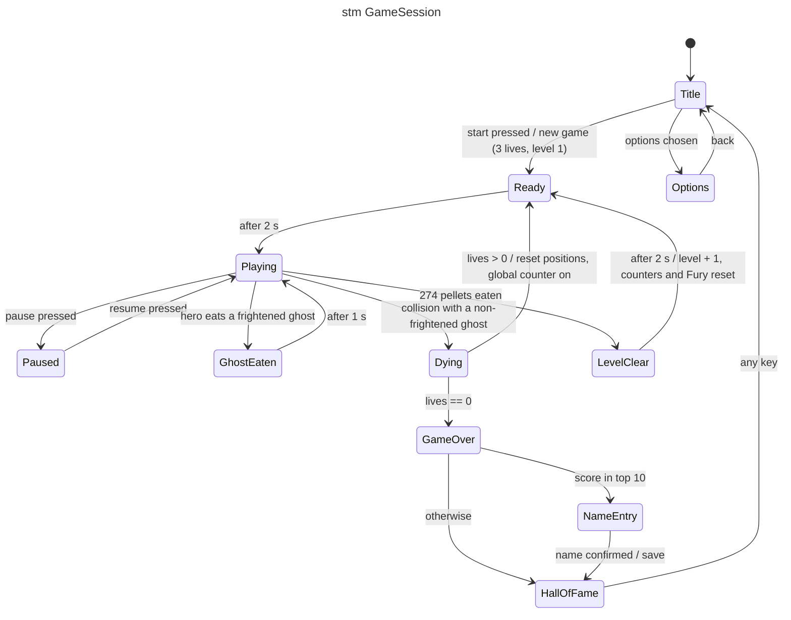

# stm — game session

## Context

Lifecycle of a game session, from the title screen to the hall of fame (GDD §10, §9.4).

## Notes

- The scatter/chase timer and fright timer only advance in `Playing` (GDD §6.4).
- `GhostEaten` and `Dying` are freeze states: the simulation steps but actors do not move.
