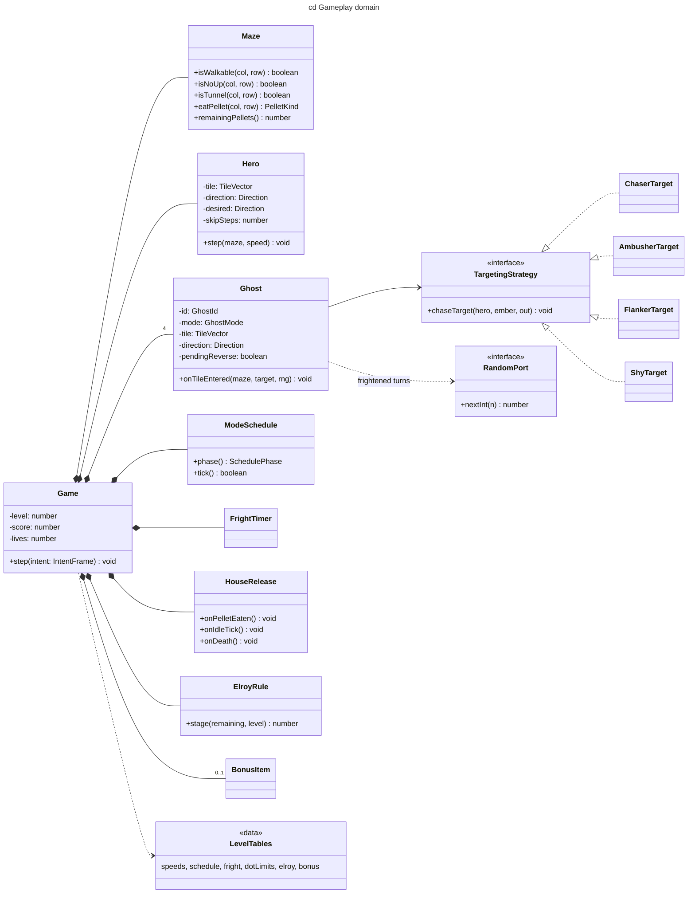

# cd — gameplay domain

## Context

Domain types of the simulation (no browser API). Fixed-size arrays only: one hero, four
ghosts, one bonus item — no pool needed, no allocation in the loop (CLAUDE.md).

## Notes

- `TargetingStrategy` writes into a preallocated `out` vector (no allocation).
- `LevelTables` hold GDD §5–§9 as data; indexes are clamped to the last row (21+, 19+ …).
- `IntentFrame`, `RandomPort` come from the ports copied from retro-shmup (ADR-0003).
