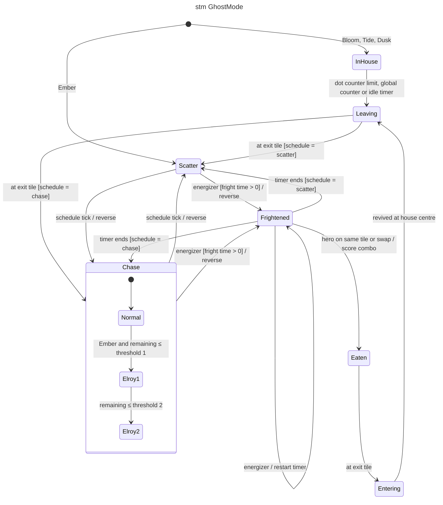

# stm — ghost mode

## Context

Lifecycle of one ghost (GDD §6, §7, §8). The global scatter/chase phase is owned by the
`ModeSchedule`; each ghost follows it while not frightened, eaten or in the house.

## Notes

- Energizer with fright time 0: Scatter/Chase reverse but stay in place (no `Frightened`).
- Elroy applies to Ember only, also in scatter (Ember keeps the chase target); suspended after
  a death until Dusk leaves the house (GDD §8). Drawn inside `Chase` for readability.
- Ghosts in the house during an energizer turn blue but stay `InHouse` (GDD §6.5).
- Leaving frightened never reverses (GDD §5.3).
