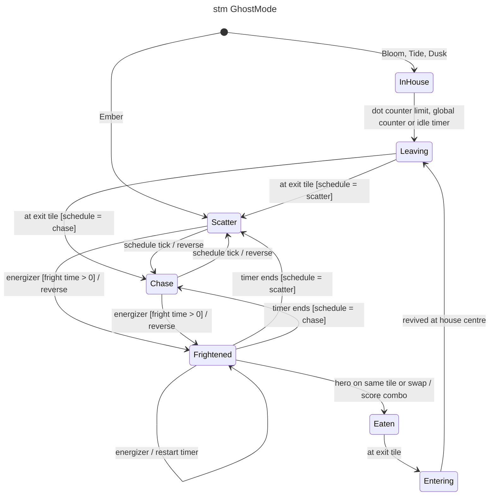
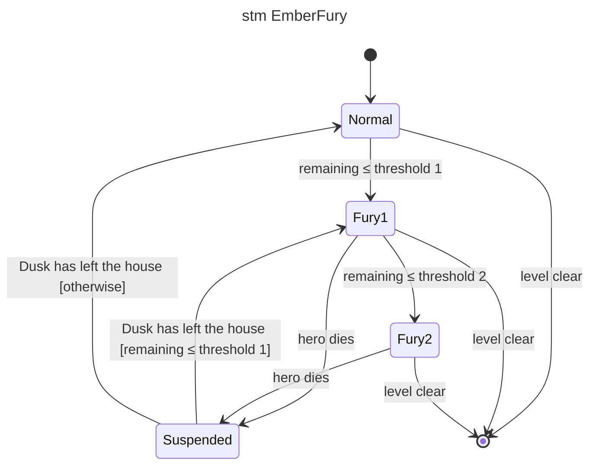

# stm — ghost mode

## Context

Lifecycle of one ghost (GDD §6, §7, §8). The global scatter/chase phase is owned by the
`ModeSchedule`; each ghost follows it while not frightened, eaten or in the house.

Fury is orthogonal to the mode above (it applies in scatter and chase alike), so it has its
own machine, owned by `FuryRule` for Ember only:

## Notes

- Energizer with fright time 0: Scatter/Chase reverse but stay in place (no `Frightened`).
- In Fury 1 / 2 Ember uses the Fury speed and keeps its chase target in scatter (GDD §8);
  from `Suspended` the stage is recomputed from the remaining pellets.
- Ghosts in the house during an energizer turn blue but stay `InHouse` (GDD §6.5).
- Leaving frightened never reverses (GDD §5.3).
