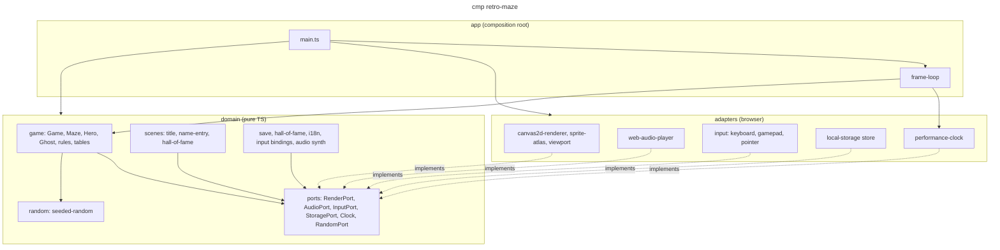

# cmp — domain / adapters / app

## Context

Structural boundaries. The dependency rule: `domain` imports nothing from `adapters` or `app`
and no browser API; adapters implement the domain's ports; `app` composes them.

## Notes

- Module origins: ADR-0003 table (retro-shmup `f698786`).
- Only `main.ts` touches `window` / `document`.
